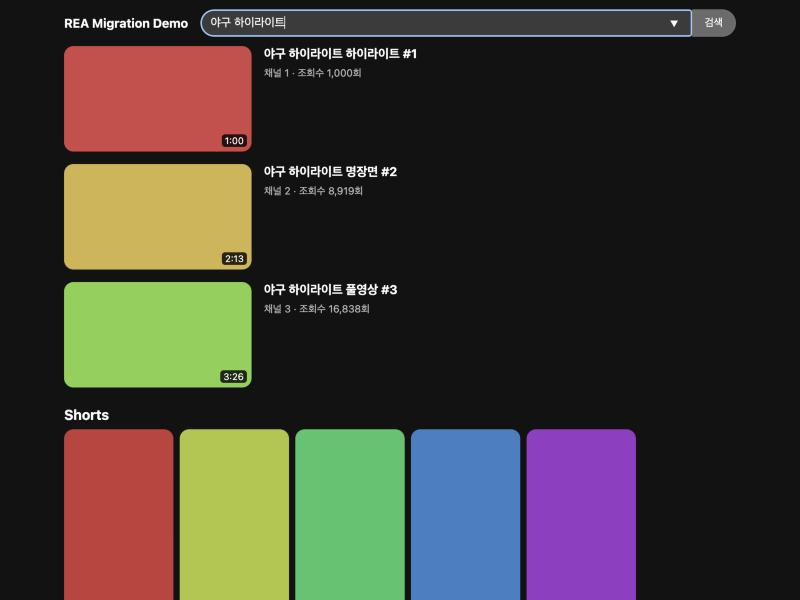

# rea-youtube-migration

REA로 YouTube 웹의 검색·무한 스크롤 구조를 분석하고, 그 결과를 근거로 React로 다시 구현한 클린룸 프로토타입.



## 흐름

1. **수집**: 사람이 크롬 시크릿 창에서 YouTube 검색 → DevTools에서 HAR(sanitized) 저장
2. **역공학**: REA로 HAR 네트워크 분석 + 스크립트 정적 분석 (오프라인)
3. **구조화**: 관측 결과를 API·패턴 표로 정리 → [docs/ANALYSIS.md](docs/ANALYSIS.md), [docs/network_digest.json](docs/network_digest.json)
4. **마이그레이션**: 패턴만 가져와 React로 새로 구현 (YouTube 코드·데이터 미사용, 목업 서버)

## 실행

```bash
pnpm install
pnpm dev     # http://localhost:5173
pnpm test    # 페이지네이션 자체 검증
```

## 구조

```
src/
  api/mockServer.js        search(query) / next(token) / suggest(prefix)
  components/ItemRenderer  type → 컴포넌트 레지스트리 (서버 주도 UI)
  components/VideoCard     영상 카드
  components/ShortsShelf   쇼츠 가로 선반
  components/SearchBar     디바운스 자동완성
  App.jsx                  IntersectionObserver 무한 스크롤
docs/ANALYSIS.md           REA 실행 명령, 결과, 한계
```

## 사용한 오픈소스

| 이름 | 버전 | 라이선스 | 용도 |
|---|---|---|---|
| REA (rea-agents) | 6.8.0 | MIT | 역공학 분석 (HAR 네트워크, JS 정적 분석) |
| Node.js | 24.22.2 | MIT | 실행 환경 |
| React / React DOM | 19.3.1 | MIT | UI |
| Vite | 7.3.7 | MIT | 개발 서버·빌드 |
| @vitejs/plugin-react | 5.2.0 | MIT | Vite React 지원 |
| pnpm | 12.8.1 | MIT | 패키지 관리 |
| fnm | - | GPL-3.0 | Node 버전 관리 |
| Python 3 (표준 라이브러리) | 3.14 | PSF | HAR 전처리·결과 요약 스크립트 |

분석 단계의 Chrome DevTools(HAR 저장)는 오픈소스 Chromium 기반 브라우저 기능.

## 주의

- 분석은 공개 페이지를 사람이 한 번 본 기록만 사용했고, 자동 수집·로그인 영역·보안 우회는 하지 않음.
- 원본 HAR·추출 스크립트는 YouTube 저작물이라 저장소에 포함하지 않음.
